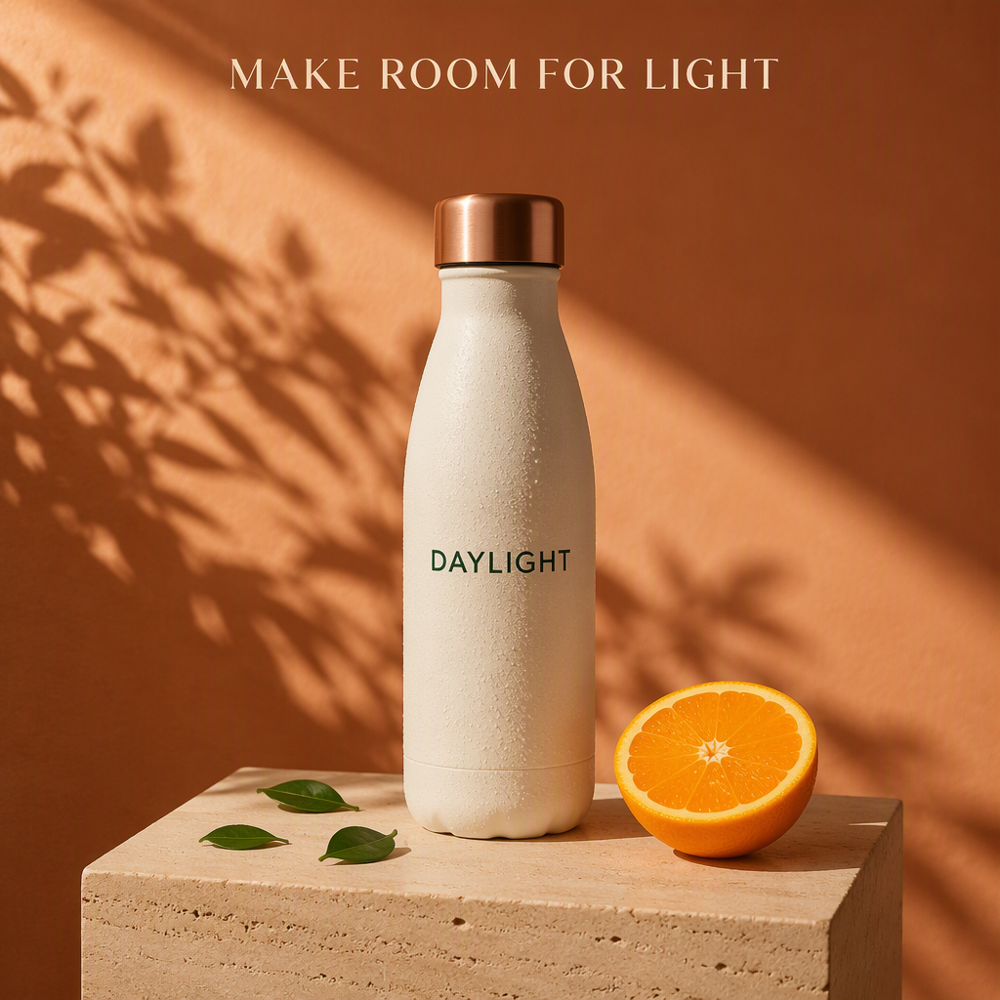
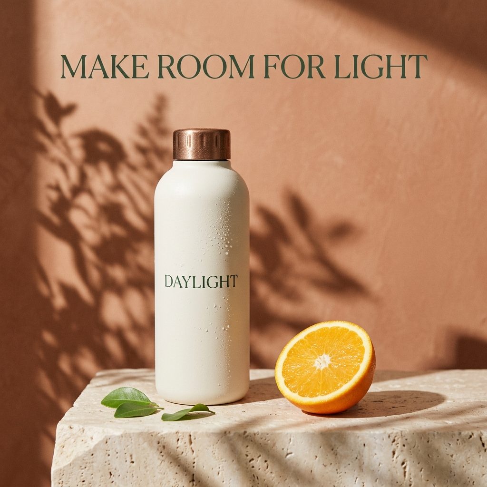
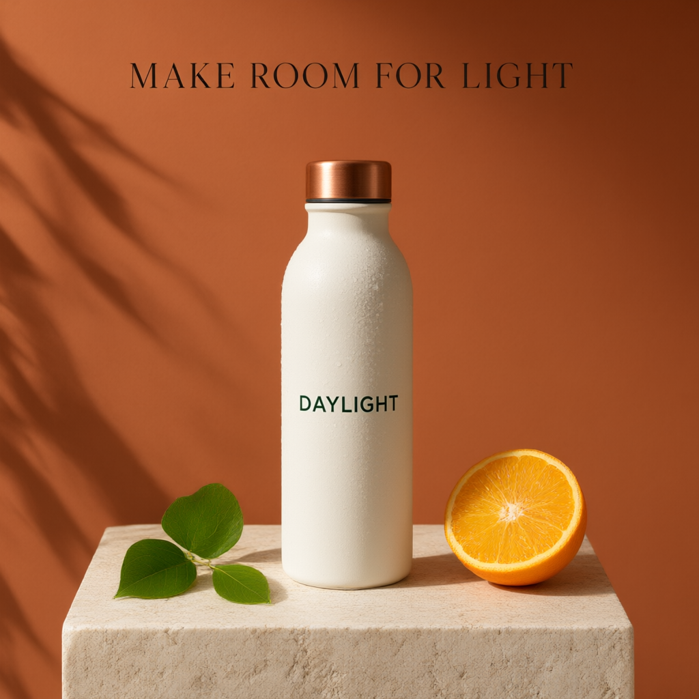
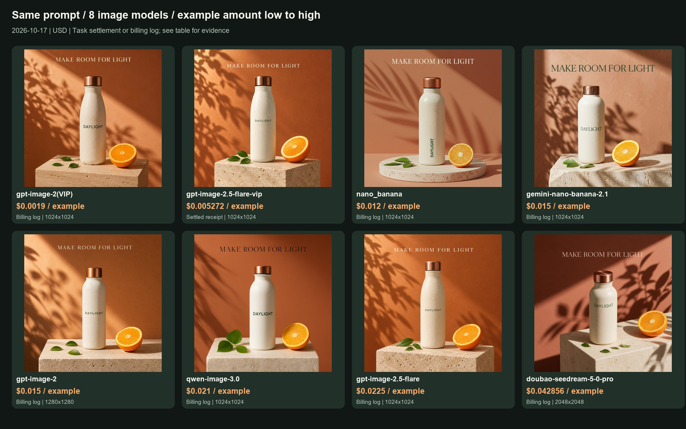

# Same-prompt image models: prices and real outputs

[English](README.md) · [简体中文](README_zh-CN.md)

Tested **2026-10-17**: the same text-to-image prompt, one output per example, sorted by example amount from low to high. **gpt-image-2(VIP) starts at $0.0019/image; low/1K here is $0.0019/image.**

Each row identifies a task settlement receipt or an account billing log. Unknown-phase logs are not final net settlements; model/time-window candidates are not confirmed task matches. Catalog rates are historical quotes, not locked prices. gpt-image-2.5-flare-vip is token-metered: **$0.005272 is this image's settled charge**, not a fixed image rate. It is a different API ID from gpt-image-2.5-flare. Qwen has no returned key quote; only its example log amount is shown.

The prompt is shared, but quality defaults and output dimensions differ. Request presets and actual pixels are listed separately. Seedream Pro requested 1K with quality omitted (medium quoted), and returned 2048×2048. These are independent ToAPIs API asset tests; they do not extend any project's native-provider, UI, import or video validation, and are not added to the historical project subtotal below.

| Model / API ID | Request preset → actual pixels | Catalog rate (2026-10-17) | Example amount USD ↑ | Cost evidence | Real output |
|---|---|---:|---:|---|---|
| gpt-image-2(VIP)<br><code>gpt-image-2-vip</code> | 1K / low → 1024×1024 | $0.0019/image | **$0.0019** | Log: model/time candidate; phase unknown | <a href="images/gpt-image-2-vip.png"></a> |
| gpt-image-2.5-flare-vip | 1024x1024 / low → 1024×1024 | Token-based; key quote unavailable | **$0.005272** | Task receipt: settled | <a href="images/gpt-image-2.5-flare-vip.png"></a> |
| nano_banana | 1K / default → 1024×1024 | $0.012/image | **$0.012** | Log: model/time candidate; phase unknown | <a href="images/nano_banana.png"></a> |
| gemini-nano-banana-2.1 | 1K / default → 1024×1024 | $0.015/image | **$0.015** | Log: model/time candidate; phase unknown | <a href="images/gemini-nano-banana-2.1.jpg"></a> |
| gpt-image-2 | 1K / default → 1280×1280 | $0.015/image | **$0.015** | Log: model/time candidate; phase unknown | <a href="images/gpt-image-2.png"></a> |
| qwen-image-3.0 | 1K / default → 1024×1024 | Key quote unavailable | **$0.021** | Log: model/time candidate; phase unknown | <a href="images/qwen-image-3.0.png"></a> |
| gpt-image-2.5-flare | 1K / high → 1024×1024 | $0.0225/image | **$0.0225** | Log: model/time candidate; phase unknown | <a href="images/gpt-image-2.5-flare.png"></a> |
| doubao-seedream-5-0-pro | 1K / default → 2048×2048 | $0.042857/image | **$0.042856** | Log: model/time candidate; phase unknown | <a href="images/doubao-seedream-5-0-pro.jpg"></a> |



[Shared prompt, originals and cost sources](README.md) · [Pricing API](https://docs.toapis.com/docs/en/api-reference/account/pricing)

## Shared prompt

```text
Create a premium product advertising photograph, square composition. A matte ivory reusable water bottle with a brushed copper cap stands on a pale travertine pedestal. Exactly three small green leaves lie beside the bottle. One fresh orange cut in half sits on the right. Warm morning sunlight enters from the upper left, casting crisp botanical shadows on a terracotta backdrop. Subtle realistic condensation droplets, tactile materials, professional studio photography. On the front of the bottle print the word "DAYLIGHT" in clean dark green uppercase type. At the top of the composition add the short headline "MAKE ROOM FOR LIGHT" in elegant readable typography. Keep generous negative space, no other text, no watermark.
```

[Request parameters and sanitized cost data](samples.json). These are real standalone API requests. Check each project adapter's model allowlist and parameter mapping before using these models through that adapter.
