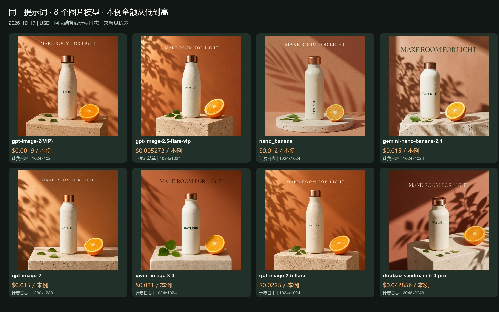

# 同一提示词：图片模型价格与真实输出

[English](README.md) · [简体中文](README_zh-CN.md)

测试日期：**2026-10-17**。8 个模型使用同一条文生图提示词，每例 1 张，按本例消费金额从低到高排列。**gpt-image-2(VIP) $0.0019/image 起；本例 low/1K 为 $0.0019/image。**

金额来自任务结算回执或账号计费日志，逐行注明来源。阶段未知的日志不代表最终净结算；按模型/时间窗口匹配的记录尚未确认到单个任务。目录价是历史报价，不是锁价。gpt-image-2.5-flare-vip 按 Token 计费，**$0.005272 仅为这一张的已结算费用**，不是固定单张价；它与 gpt-image-2.5-flare 是不同 API ID。Qwen 的目录价未返回，只展示本例日志金额。

提示词相同，模型默认质量和实际分辨率不同；表内将请求与输出分别列出。Seedream Pro 请求 1K、未传 quality（报价档位 medium），实际返回 2048×2048。这组图片是独立 ToAPIs API 素材测试，不新增任何项目原生 Provider、UI、图片导入或视频的验收结论，也不计入下方历史项目消费小计。

| 模型 / API ID | 请求档位 → 实际尺寸 | 目录价（2026-10-17） | 本例消费金额 USD ↑ | 费用依据 | 真实输出 |
|---|---|---:|---:|---|---|
| gpt-image-2(VIP)<br><code>gpt-image-2-vip</code> | 1K / low → 1024×1024 | $0.0019/image | **$0.0019** | 日志：模型/时间窗口候选；阶段未知 | <a href="images/gpt-image-2-vip.png"></a> |
| gpt-image-2.5-flare-vip | 1024x1024 / low → 1024×1024 | 按 Token；Key 报价未返回 | **$0.005272** | 任务回执 settled | <a href="images/gpt-image-2.5-flare-vip.png"></a> |
| nano_banana | 1K / default → 1024×1024 | $0.012/image | **$0.012** | 日志：模型/时间窗口候选；阶段未知 | <a href="images/nano_banana.png"></a> |
| gemini-nano-banana-2.1 | 1K / default → 1024×1024 | $0.015/image | **$0.015** | 日志：模型/时间窗口候选；阶段未知 | <a href="images/gemini-nano-banana-2.1.jpg"></a> |
| gpt-image-2 | 1K / default → 1280×1280 | $0.015/image | **$0.015** | 日志：模型/时间窗口候选；阶段未知 | <a href="images/gpt-image-2.png"></a> |
| qwen-image-3.0 | 1K / default → 1024×1024 | Key 报价未返回 | **$0.021** | 日志：模型/时间窗口候选；阶段未知 | <a href="images/qwen-image-3.0.png"></a> |
| gpt-image-2.5-flare | 1K / high → 1024×1024 | $0.0225/image | **$0.0225** | 日志：模型/时间窗口候选；阶段未知 | <a href="images/gpt-image-2.5-flare.png"></a> |
| doubao-seedream-5-0-pro | 1K / default → 2048×2048 | $0.042857/image | **$0.042856** | 日志：模型/时间窗口候选；阶段未知 | <a href="images/doubao-seedream-5-0-pro.jpg"></a> |



[共同提示词、原图与费用来源](README_zh-CN.md) · [Pricing API](https://docs.toapis.com/docs/en/api-reference/account/pricing)

## 共同提示词

```text
Create a premium product advertising photograph, square composition. A matte ivory reusable water bottle with a brushed copper cap stands on a pale travertine pedestal. Exactly three small green leaves lie beside the bottle. One fresh orange cut in half sits on the right. Warm morning sunlight enters from the upper left, casting crisp botanical shadows on a terracotta backdrop. Subtle realistic condensation droplets, tactile materials, professional studio photography. On the front of the bottle print the word "DAYLIGHT" in clean dark green uppercase type. At the top of the composition add the short headline "MAKE ROOM FOR LIGHT" in elegant readable typography. Keep generous negative space, no other text, no watermark.
```

[请求参数与脱敏费用数据](samples.json)。这里列出真实独立 API 请求；使用各项目适配器前，仍需核对它的模型白名单及参数映射。
