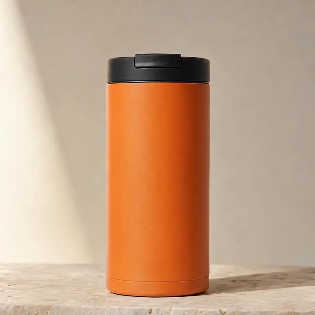
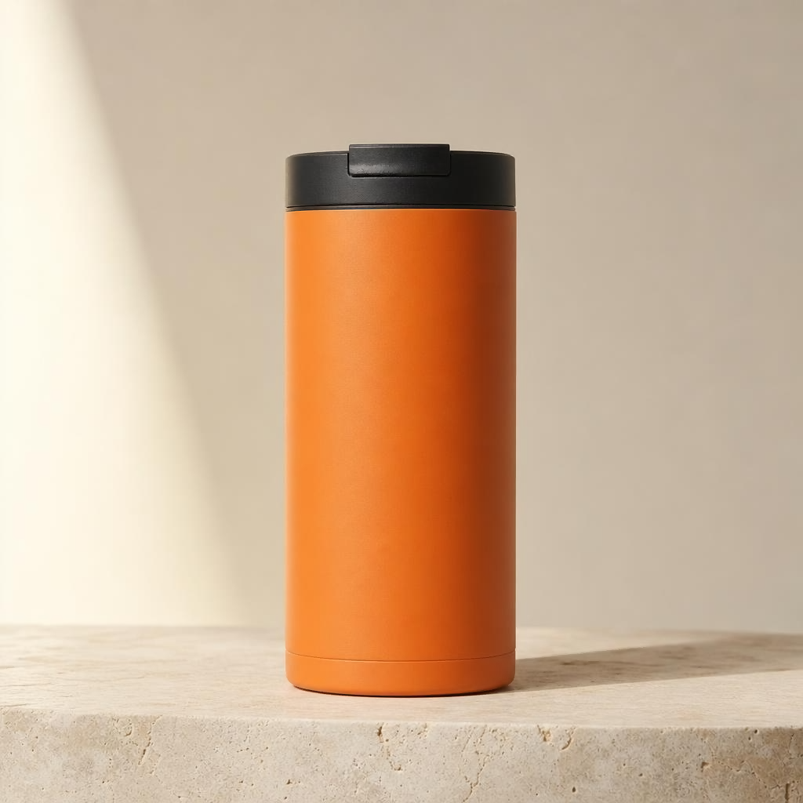

# Generate and save a product image with the TongFlow ToAPIs plugin

<!-- TOAPIS-OWNER-INVITE -->
[Sign up / use ToAPIs](https://toapis.com/login?aff=BEWR)
<!-- /TOAPIS-OWNER-INVITE -->


<!-- TOAPIS-MODELS-20261020 -->
## Model support and prices · 2026-10-20

Added standalone API presets: 31 image request templates and 8 video presets. Current-key pricing matches 26 image and 8 video presets; 5 image templates block new paid calls while pricing is unavailable. Native provider/UI/import/render acceptance remains as documented in the original guide below.

| Image model / tested preset | Current preset quote / image | Historical example amount / image | Fee evidence |
|---|---:|---:|---|
| gpt-image-2(VIP)<br><sub>low</sub> | $0.0019/image | **$0.0019/image** | Billing log, phase unknown |
| gpt-image-2.5-flare-vip<br><sub>low</sub> | Current-key quote unavailable | **$0.005272/image**<br><sub>Token-metered; current $/M unavailable. This sample is not a fixed image tariff.</sub> | Task receipt settled |
| nano_banana<br><sub>1K</sub> | $0.012/image | **$0.012/image** | Billing log, phase unknown |
| gemini-nano-banana-2.1<br><sub>1K</sub> | $0.015/image | **$0.015/image** | Billing log, phase unknown |
| gpt-image-2<br><sub>1K</sub> | $0.015/image | **$0.015/image** | Billing log, phase unknown |
| gemini-nano-banana-2.1-vip<br><sub>1K</sub> | $0.02/image | **$0.02/image** | Billing log, phase unknown |
| qwen-image-3.0<br><sub>1K</sub> | Current-key quote unavailable | **$0.021/image** | Billing log, phase unknown |
| gpt-image-2.5-flare<br><sub>high</sub> | $0.0225/image | **$0.0225/image** | Billing log, phase unknown |
| gpt-image-2.5-sunburst<br><sub>high</sub> | $0.0225/image | **$0.0225/image** | Billing log, phase unknown |
| flux-2-pro<br><sub>1K</sub> | $0.025/image | **$0.025/image** | Billing log, phase unknown |
| doubao-seedream-5-0-pro<br><sub>1K</sub> | $0.042857/image | **$0.042856/image** | Billing log, phase unknown |

| Video model | Preset / input | Settled clip charge | File duration | Case USD/s, ascending |
|---|---|---:|---:|---|
| MiniMax-H3-Max-Turbo | 5s / 480P / text-to-video | $0.125/clip | 5.18s | **$0.024131/s**<br><sub>Pricing tariff: $0.025/s</sub> |
| seedance-2-mini | 4s / 480p / first-frame | $0.13338/clip | 4.04s | **$0.033015/s**<br><sub>Pricing tariff: $3.285714/M total tokens</sub> |
| seedance-2-fast | 4s / 480p / text-to-video | $0.214568/clip | 4.04s | **$0.053111/s**<br><sub>Pricing tariff: $5.285714/M total tokens</sub> |
| kling-v3 | 5s / 720p / std / text-to-video | $0.3/clip | 5.04s | **$0.059524/s**<br><sub>Pricing tariff: $0.06/s</sub> |
| MiniMax-H3 | 5s / 768p / text-to-video | $0.32/clip | 5.17s | **$0.061896/s**<br><sub>Pricing tariff: $0.064/s</sub> |
| seedance-2 | 4s / 480p / first-frame | $0.26676/clip | 4.04s | **$0.06603/s**<br><sub>Pricing tariff: $6.571429/M total tokens</sub> |
| kling-3.0-turbo | 4s / 720p / text-to-video | $0.32/clip | 4.04s | **$0.079208/s**<br><sub>Pricing tariff: $0.08/s</sub> |
| seedance-2-5 | 4s / 480p / text-to-video | $0.3883/clip | 4.04s | **$0.096114/s**<br><sub>Pricing tariff: $10/M total tokens</sub> |

Pricing checked 2026-10-20. Image examples are dated 2026-10-17; video examples 2026-10-20. Tables sort by example amount or case USD/s. Presets and input modes differ; this is not a matched-settings quality ranking. Unknown-phase image logs are not confirmed final net settlements. Current quotes and historical amounts are separate. Video charges are billing=settled; case USD/s divides charge by actual file duration, never processing time. Token tariffs appear in small text and do not imply a fixed per-second price.

gpt-image-2(VIP) starts at $0.0019/image; this low/1K preset is $0.0019/image. The standalone sampler has 31 historically successful image request templates and 8 video presets. Current-key pricing matches 26 image and 8 video presets; 5 image templates block new paid submission until an exact price is available.

[Local sampler](../../toapis-models/README.md) · [Full price table](../../PRICING.md) · [Original media and fee evidence](https://github.com/ToAPIs-2025/toapis-quickstart/tree/main/tutorials/model-support-2026-10-20)

Original project examples, historical charges and integration instructions follow. Historical amounts are not rewritten as today’s quotes.

<!-- /TOAPIS-MODELS-20261020 -->

<!-- TOAPIS-MODEL-COST-UPDATE-20261016 -->
## Tested model types, presets and costs

Updated October 16, 2026. These are tested historical presets/prices; this addition does not relabel the original batch below.

| Model (API ID) | Type | Tested preset | Unit quote | Confirmed unit charge | Count |
|---|---|---|---:|---:|---:|
| gpt-image-2 | Image | 1K / n=1 | $0.015/image | unverified | 1 |

Historical image charges remain unverified; quotes are not billed amounts.

Original image CLI validated; the video addition tests the real SDK handler with an explicit-parameter/durable-transport wrapper, not canvas acceptance.

[Video additions, parameters, costs and reuse](video_extra/README.md)
<!-- TOAPIS-VIDEO-PREVIEWS-20261016 -->
### Seedance video demos and clip costs

[](https://raw.githubusercontent.com/ToAPIs-2025/toapis-quickstart/main/tutorials/tongflow-toapis-image/video_extra/clips/seedance-2-mini.mp4)

**Seedance 2 Mini** · 480p · 4.04s · **$0.127484/clip** · about $0.031555/s

API settlement matches the owner-confirmed charges. USD/s is specific to these clips.

<!-- /TOAPIS-VIDEO-PREVIEWS-20261016 -->
<!-- /TOAPIS-MODEL-COST-UPDATE-20261016 -->

<!-- TOAPIS-IMAGE-SAMPLES-20261017 -->
## Same prompt: 8 image models and example costs

Tested **2026-10-17**: the same text-to-image prompt, one output per example, sorted by example amount from low to high. **gpt-image-2(VIP) starts at $0.0019/image; low/1K here is $0.0019/image.**

Each row identifies a task settlement receipt or an account billing log. Unknown-phase logs are not final net settlements; model/time-window candidates are not confirmed task matches. Catalog rates are historical quotes, not locked prices. gpt-image-2.5-flare-vip is token-metered: **$0.005272 is this image's settled charge**, not a fixed image rate. It is a different API ID from gpt-image-2.5-flare. Qwen has no returned key quote; only its example log amount is shown.

The prompt is shared, but quality defaults and output dimensions differ. Request presets and actual pixels are listed separately. Seedream Pro requested 1K with quality omitted (medium quoted), and returned 2048×2048. These are independent ToAPIs API asset tests; they do not extend any project's native-provider, UI, import or video validation, and are not added to the historical project subtotal below.

| Model / API ID | Request preset → actual pixels | Catalog rate (2026-10-17) | Example amount USD ↑ | Cost evidence | Real output |
|---|---|---:|---:|---|---|
| gpt-image-2(VIP)<br><code>gpt-image-2-vip</code> | 1K / low → 1024×1024 | $0.0019/image | **$0.0019** | Log: model/time candidate; phase unknown | <a href="https://raw.githubusercontent.com/ToAPIs-2025/toapis-quickstart/main/tutorials/image-model-samples-2026-10-17/images/gpt-image-2-vip.png"></a> |
| gpt-image-2.5-flare-vip | 1024x1024 / low → 1024×1024 | Token-based; key quote unavailable | **$0.005272** | Task receipt: settled | <a href="https://raw.githubusercontent.com/ToAPIs-2025/toapis-quickstart/main/tutorials/image-model-samples-2026-10-17/images/gpt-image-2.5-flare-vip.png"></a> |
| nano_banana | 1K / default → 1024×1024 | $0.012/image | **$0.012** | Log: model/time candidate; phase unknown | <a href="https://raw.githubusercontent.com/ToAPIs-2025/toapis-quickstart/main/tutorials/image-model-samples-2026-10-17/images/nano_banana.png"></a> |
| gemini-nano-banana-2.1 | 1K / default → 1024×1024 | $0.015/image | **$0.015** | Log: model/time candidate; phase unknown | <a href="https://raw.githubusercontent.com/ToAPIs-2025/toapis-quickstart/main/tutorials/image-model-samples-2026-10-17/images/gemini-nano-banana-2.1.jpg"></a> |
| gpt-image-2 | 1K / default → 1280×1280 | $0.015/image | **$0.015** | Log: model/time candidate; phase unknown | <a href="https://raw.githubusercontent.com/ToAPIs-2025/toapis-quickstart/main/tutorials/image-model-samples-2026-10-17/images/gpt-image-2.png"></a> |
| qwen-image-3.0 | 1K / default → 1024×1024 | Key quote unavailable | **$0.021** | Log: model/time candidate; phase unknown | <a href="https://raw.githubusercontent.com/ToAPIs-2025/toapis-quickstart/main/tutorials/image-model-samples-2026-10-17/images/qwen-image-3.0.png"></a> |
| gpt-image-2.5-flare | 1K / high → 1024×1024 | $0.0225/image | **$0.0225** | Log: model/time candidate; phase unknown | <a href="https://raw.githubusercontent.com/ToAPIs-2025/toapis-quickstart/main/tutorials/image-model-samples-2026-10-17/images/gpt-image-2.5-flare.png"></a> |
| doubao-seedream-5-0-pro | 1K / default → 2048×2048 | $0.042857/image | **$0.042856** | Log: model/time candidate; phase unknown | <a href="https://raw.githubusercontent.com/ToAPIs-2025/toapis-quickstart/main/tutorials/image-model-samples-2026-10-17/images/doubao-seedream-5-0-pro.jpg"></a> |


[Shared prompt, originals and cost sources](https://github.com/ToAPIs-2025/toapis-quickstart/tree/main/tutorials/image-model-samples-2026-10-17/README.md) · [Pricing API](https://docs.toapis.com/docs/en/api-reference/account/pricing)

<!-- /TOAPIS-IMAGE-SAMPLES-20261017 -->

[简体中文](README_zh-CN.md) · [Model and pricing](https://go.toapis.com/1012_tongflow_gh_en) · [Original plugin](https://github.com/tong-io/tongflow-router-toapis)

Use your own ToAPIs key with the existing TongFlow plugin. This reproduces an unmodified image-gen CLI route, not a validated canvas workflow or a partnership announcement.



## Tested scope and price

Oct 12, 2026: plugin `46724d2aa05cf26ba98fcecc76a95145c83d35d3`, SDK `tongflow==0.3.4`, image-gen, standard `gpt-image-2`. Input width/height 1024; actual PNG 1024×1024. The CLI returned success=true and an Image Asset with bytesBase64. A single run took 46.70 seconds; this is not an average-time guarantee. [Evidence](evidence.json)

Read-only quote checked today: 1K/n=1 $0.015 per request, 2K $0.020, 4K $0.025. This plugin case validates only 1K, and does not promise control of other tiers. Historical billing was null; actual charges are unverified. [Dated quote](pricing.json)

## 1 Install the fixed plugin and SDK

Use Git, Python 3.10+ and PowerShell 7 for the Windows example. Clone both repositories in one workspace:

```powershell
git clone https://github.com/ToAPIs-2025/toapis-quickstart.git
git clone https://github.com/tong-io/tongflow-router-toapis.git
git -C tongflow-router-toapis checkout 46724d2aa05cf26ba98fcecc76a95145c83d35d3
Copy-Item toapis-quickstart/tutorials/tongflow-toapis-image/request.json tongflow-router-toapis/
Copy-Item toapis-quickstart/tutorials/tongflow-toapis-image/decode_asset.py tongflow-router-toapis/
cd tongflow-router-toapis
python -m venv .venv
.\.venv\Scripts\Activate.ps1
python -m pip install tongflow==0.3.4
```

On macOS/Linux activate with `source .venv/bin/activate`. The plugin and SDK retain their upstream licenses; review LICENSE and CLA before deriving or redistributing your own work. This tutorial does not redistribute them.

## 2 Configure and generate one image

`request.json` includes the real original prompt, explicit model and dimensions. Configure your own key privately. The example below requires PowerShell 7 for MaskInput and submits one potentially billable image:

```powershell
$env:TOAPIS_API_KEY = Read-Host "Paste your own API key" -MaskInput
$env:TOAPIS_BASE_URL = "https://toapis.cn/v1"
Get-Content request.json -Raw | python entry.py > response.json
python decode_asset.py response.json --output result.png
Remove-Item Env:TOAPIS_API_KEY
```

Use `https://toapis.com/v1` internationally or `https://toapis.cn/v1` for mainland China. Keep /v1 once. On POSIX, set the same environment variables privately and use `python entry.py < request.json > response.json`, then run the decoder. Do not print the entire base64 Asset into a public log.

## 3 Inspect and reuse

The decoder requires success=true, image.bytesBase64 and a PNG header. Open result.png and check its dimensions. Change the product, material, surface and lighting in [request.json](request.json), keeping gpt-image-2 and 1024 dimensions for the first reproduction. Each invocation is a separate image job. Generated product details still require review.

Reuse this as a plugin invocation, setup check and evidence template. A canvas tutorial needs separate tests for plugin loading, node wiring, Asset preview and file saving; CLI success does not establish those paths.

## API and recovery

Bearer authentication; POST `/v1/images/generations`, then GET `/v1/images/generations/{id}`. On completion the plugin downloads the image and serializes a TongFlow Asset. Keep the original task ID after interruption and query it before submitting another job. For 401 check the private key, and for 400 check the model and parameters.

Passed at this version: image-gen CLI, async task handling, PNG download and Asset serialization. The original October 12 image test did not cover canvas, editing/fusion, text, video, audio or throughput. The October 16 video SDK-handler test is documented separately above; canvas and other slots remain unvalidated. An existing plugin is not evidence of a commercial partnership.

[Step screenshots](screenshots/) are browser captures of authored tutorial pages with the real output; they do not show canvas UI.
